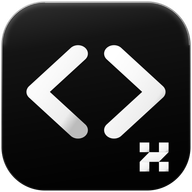

<p align="center">
  <a href="https://hanzo.ai">
    
  </a>
</p>

<h1 align="center">&lt;/&gt; Hanzo Dev</h1>

[](https://hanzo.app/dev/open?repo=github.com/hanzoai/dev&ref=main&action=open) [](https://hanzo.app/dev/open?repo=github.com/hanzoai/dev&ref=main&action=edit) [](https://hanzo.app/dev/open?repo=github.com/hanzoai/dev&ref=main&action=deploy)

<p align="center">The unified multi-agent control plane for coding agents across Desktop, Web, Mobile, and Cloud.</p>

<p align="center">
  <a href="https://github.com/hanzoai/dev/releases/latest">Download for desktop</a> ·
  <a href="https://dev.hanzo.ai">Web</a> ·
  <a href="https://dev.hanzo.ai/ios">iOS (TestFlight, coming soon)</a> ·
  <a href="./docs/user/install.md">Install guide</a>
</p>

> Hanzo Dev v1, the terminal agent, lives at [hanzoai/dev-v1](https://github.com/hanzoai/dev-v1). The command line going forward is `hanzo`.

Hanzo Dev runs every coding agent on your machine—and connects to your local `hanzod` private AI node or `hanzo.ai` cloud account—in one unified interface. Start a thread at your desk, jump directly into **Hanzo IDE**, or approve the next step from your phone.

It works out-of-the-box with **Hanzo (`hanzo` / `hanzod`)**, **Claude Code**, **Codex**, **Cursor**, **OpenCode**, **Grok Build**, **Antigravity**, **Kiro**, **Pi**, **Muse Code**, **fx**, and any [ACP](./docs/user/providers-acp.md) agent.

## Features

- **Every agent & account in one place.** Auto-discovers installed agents and logged-in accounts on your computer. Switch models mid-thread or hand tasks across agents.
- **Local Private AI (`hanzod`) + Cloud (`hanzo.ai`).** Connect directly to your local `hanzod` runtime (`http://127.0.0.1:9630` / `http://127.0.0.1:3690`) or sign in with your `hanzo.ai` account.
- **One-click "Open in Hanzo IDE".** Jump from any thread or git worktree in Hanzo Dev straight into `/Applications/Hanzo IDE.app` (or Cursor, VS Code, Zed, Ghostty, Xcode).
- **Real-Time Voice & Dictation.** Integrated voice prompt dictation and works seamlessly with **Hanzo Command** (`~/work/hanzo/command`) in the macOS Menu Bar (`fn` hold to dictate, `fn fn` double-tap for continuous real-time Jarvis voice loop).
- **Built-in Git Worktrees & Diff Review.** Isolate agent threads in dedicated git worktrees, inspect diffs, and commit/PR in one click.

## Running Locally

```bash
git clone https://github.com/hanzoai/dev.git
cd dev
COREPACK_ENABLE_DOWNLOAD_PROMPT=0 pnpm install

# Build & launch the production-bundled native desktop app (fastest, zero HMR lag)
COREPACK_ENABLE_DOWNLOAD_PROMPT=0 pnpm run build:desktop
COREPACK_ENABLE_DOWNLOAD_PROMPT=0 pnpm run start:desktop

# Or launch with live Vite HMR watchers for UI development
COREPACK_ENABLE_DOWNLOAD_PROMPT=0 pnpm run dev:desktop

# Or run web + orchestration server directly in your browser (http://127.0.0.1:5733)
COREPACK_ENABLE_DOWNLOAD_PROMPT=0 pnpm run dev
```

- **Desktop App**: Launches native `Hanzo Dev` (**Rust Tauri v2 + WKWebView/Metal** shell, ~15 MB footprint, native OS Keychain IAM vault, monochrome dark/light UI, official Hanzo icon and menu bar)
- **Web Control Plane**: `http://127.0.0.1:5733` (if running `dev:desktop` and opening in Safari/Chrome, run `node apps/server/dist/bin.mjs pair --base-dir ~/.hanzo-dev` for a local pairing URL)
- **Orchestration Server**: `http://127.0.0.1:13773`

## License

MIT Licensed — Copyright (c) 2026 Hanzo AI Inc. See [LICENSE](./LICENSE).
